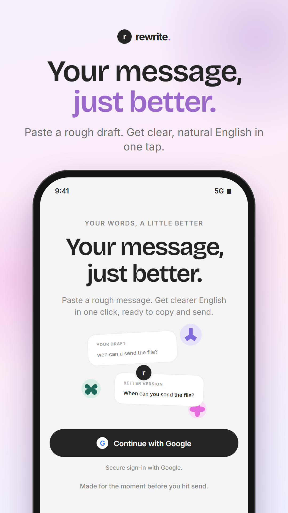
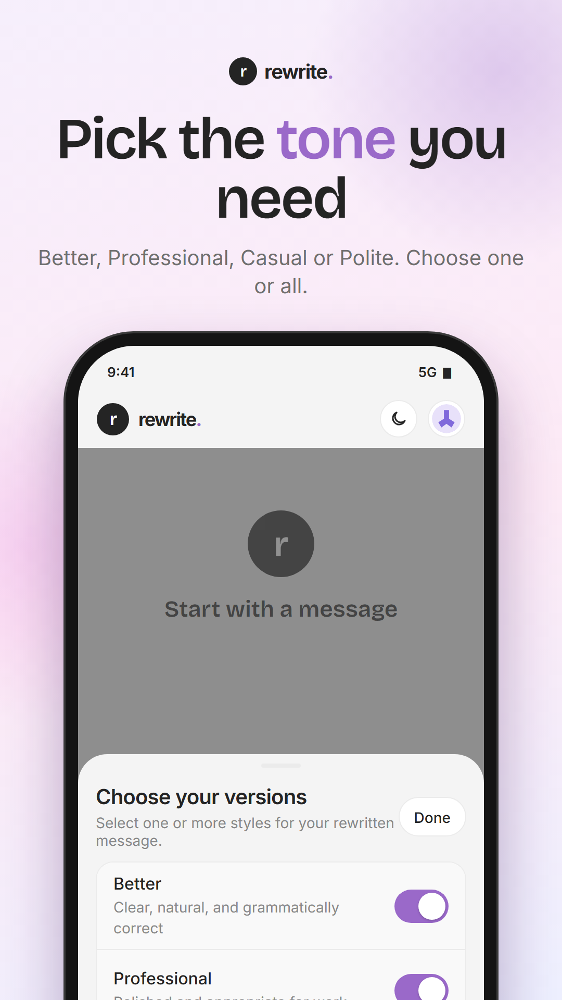
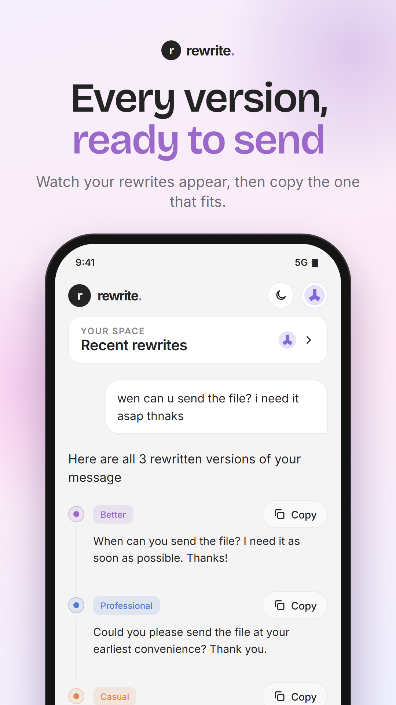
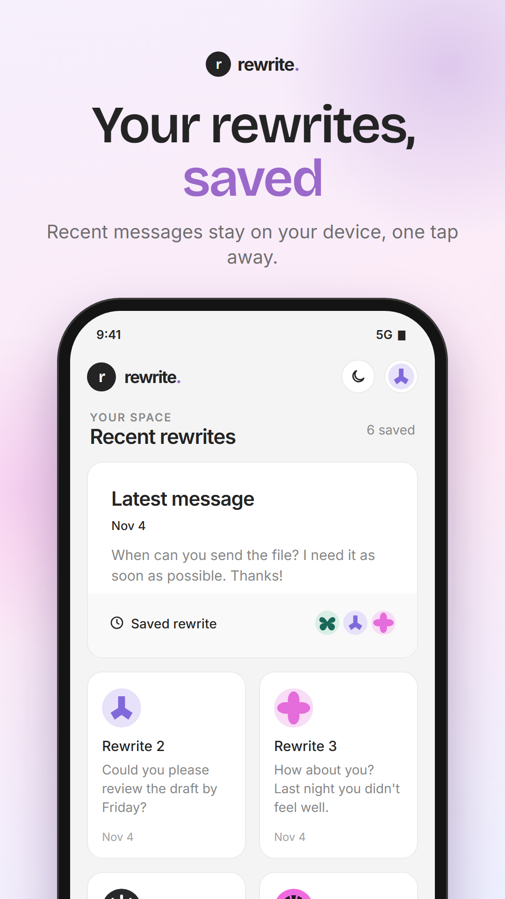
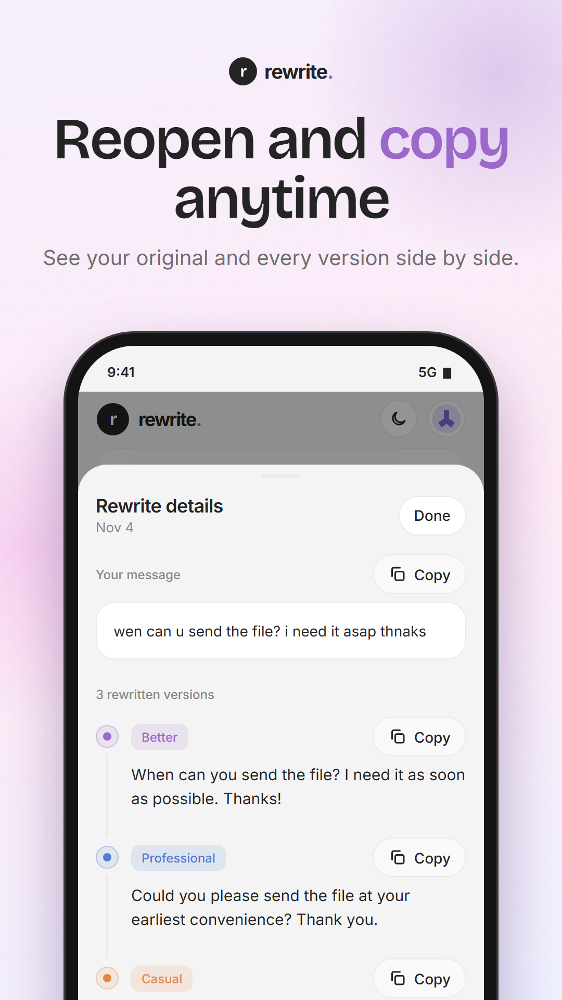
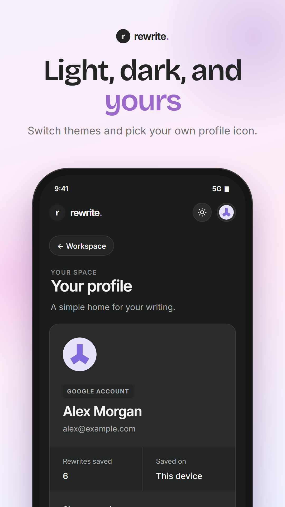

# Rewrite AI

**Your message, just better.** Rewrite AI is a mobile app (iOS and Android, built with Expo and React Native) that turns a rough draft into clear, natural English in one tap. Paste a message, pick the tones you want, and get ready-to-send versions you can copy straight into any chat or email.

## The problem it solves

Most of us write quick messages that are unclear, too blunt, or full of typos, then spend time rewording them or paste them into a general chatbot and write a prompt each time. Rewrite AI removes that friction:

- **No prompting.** You paste text; the app knows what to do with it.
- **Several tones at once.** Get a *Better*, *Professional*, *Casual* and *Polite* version side by side and choose the one that fits.
- **One-tap copy.** Every version has its own Copy button.
- **Nothing gets lost.** Your recent rewrites are kept on the device, with all their versions, so you can reopen and copy them later.

## How it works

1. **Sign in** with Google (handled by Supabase Auth).
2. **Write or paste** your draft into the message box.
3. **Choose versions** with the **+** button: toggle Better, Professional, Casual and Polite. Pick the output language (English or Hindi) from the dropdown.
4. **Send.** Your draft appears as a bubble on the right, an AI "thinking" line shows progress, then each version types itself out in order on a timeline.
5. **Copy** any version, or open **Recent rewrites** to revisit older drafts.

Under the hood, the app sends your text, the language and the chosen styles to a Supabase Edge Function named `rewrite-message` (see [`src/lib/rewriteApi.js`](src/lib/rewriteApi.js)). It returns one output per requested style, which the app renders and saves locally.

## App preview

<p align="center">
  
  
  
</p>
<p align="center">
  
  
  
</p>

## Screens and features

1. **Sign in.** One tap with Google. The login screen shows the idea at a glance: a rough draft becomes a clean version.
2. **Pick the tone.** Open the version picker with the **+** button and toggle Better, Professional, Casual and Polite. Choose English or Hindi output from the language dropdown. When the message box is empty, its border plays a soft purple and pink gradient sweep.
3. **Every version, ready to send.** Your draft appears as a bubble on the right, a short "thinking" line follows, then each version types itself out in order on a timeline, with light haptics while typing. Every version has its own Copy button.
4. **Recent rewrites.** Saved rewrites appear as cards with a "Latest message" highlight.
5. **Reopen and copy anytime.** Tap any card to open a sheet with your original message and every version generated for it, each with a Copy button.
6. **Light, dark, and yours.** Switch between light and dark themes, see your account and saved-rewrite count, and choose one of 11 profile icons.

Also included: a fixed header with scrolling content, a keyboard-aware composer on iOS and Android, and a branded loading screen while sign-in completes.

> The preview images are generated from the app's design tokens (colors, type and components) with sample content. To regenerate them, run `python docs/store-preview/build.py`, then render each slide with headless Chrome at 1080 x 1920 (`preview.html?n=1` to `?n=6`).

## Tech stack

- Expo SDK 58, React Native 0.88, Expo Router
- Supabase (Auth with Google, Edge Functions)
- React Native Reanimated, `react-native-svg`, `expo-haptics`
- AsyncStorage for on-device history, theme and profile icon

## Getting started

Requires Node.js 22.13 or newer.

```bash
git clone https://github.com/aniket-raikwar-dev/rewrite-app.git
cd rewrite-app
npm install
```

Create a `.env` file in the project root (it is not committed):

```
EXPO_PUBLIC_SUPABASE_URL=your-supabase-project-url
EXPO_PUBLIC_SUPABASE_KEY=your-supabase-anon-key
```

Then start the app:

```bash
npx expo start
```

Google sign-in uses the `rewrite-ai://auth/callback` link, so it needs a development build rather than Expo Go:

```bash
npx expo run:android
```

Add `rewrite-ai://auth/callback` to the Redirect URLs in your Supabase project (Authentication → URL Configuration).

## Project structure

```
src/
  app/          Expo Router routes (login, workspace, history, profile, auth callback)
  components/   Screens and shared UI
  lib/          Supabase client, auth, rewrite API, haptics helpers
  state/        App-wide state (session, history, theme)
```

## Scripts

```bash
npx expo lint        # lint
npx tsc --noEmit     # typecheck
```
